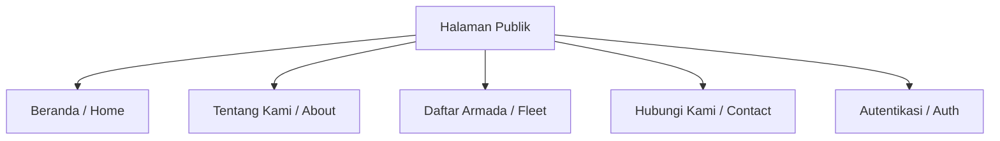
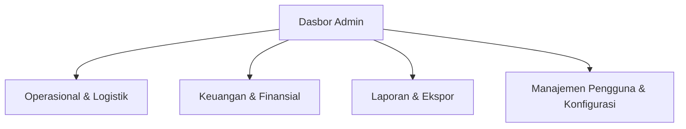
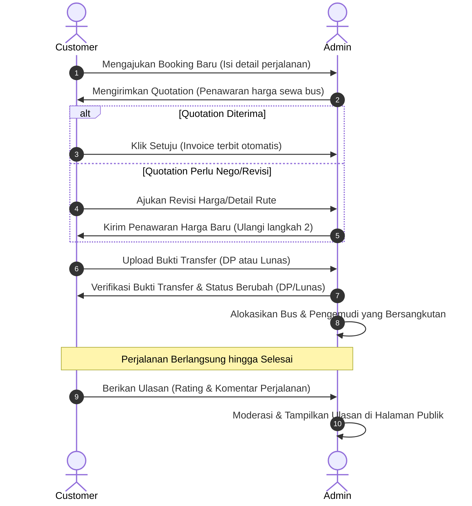

# Dokumentasi Fitur & Kegunaan Sistem Boneh Star
Sistem Informasi Manajemen dan Pemesanan Armada Bus PO Boneh Star

> [!NOTE]
> Dokumen ini dirancang sebagai panduan lengkap untuk menjelaskan arsitektur fungsional, fitur-fitur utama, dan kegunaan operasional dari platform Boneh Star. Dokumen ini dapat digunakan sebagai referensi penyusunan Bab IV/V Laporan Tugas Akhir (TA) untuk memetakan implementasi sistem.

---

## 📌 Daftar Isi
1. [Ringkasan Eksekutif Sistem](#-ringkasan-eksekutif-sistem)
2. [Aktor dan Hak Akses (User Roles)](#-aktor-dan-hak-akses-user-roles)
3. [Modul 1: Halaman Publik (Public Area)](#-modul-1-halaman-publik-public-area)
4. [Modul 2: Dasbor Pelanggan (Customer Area)](#-modul-2-dasbor-pelanggan-customer-area)
5. [Modul 3: Dasbor Administrator (Admin Area)](#-modul-3-dasbor-administrator-admin-area)
6. [Alur Kerja Bisnis Utama (Core Workflow)](#-alur-kerja-bisnis-utama-core-workflow)
7. [Fitur Keselamatan & Manajemen Konflik Data](#-fitur-keselamatan--manajemen-konflik-data)

---

## 🏢 Ringkasan Eksekutif Sistem

**Boneh Star** adalah platform digital berbasis web yang mengintegrasikan seluruh proses operasional Perusahaan Otobus (PO) Boneh Star. Sistem ini menggantikan pencatatan manual dan koordinasi WhatsApp-only menjadi satu kesatuan basis data yang terstruktur. Platform ini mencakup:
*   Pemesanan armada bus secara real-time.
*   Negosiasi penawaran harga sewa (Quotation Loop) langsung di dalam sistem.
*   Verifikasi pembayaran multi-tahap (DP dan Pelunasan).
*   Manajemen logistik internal (alokasi bus, jadwal pengemudi, ketersediaan armada).
*   Pelaporan analitik pendapatan serta tingkat kepuasan pelanggan secara otomatis.

---

## 👥 Aktor dan Hak Akses (User Roles)

Sistem ini membagi aksesibilitas data ke dalam 3 aktor utama untuk menjaga keamanan informasi dan efisiensi birokrasi:

| Aktor | Deskripsi Peran | Batasan Akses |
| :--- | :--- | :--- |
| **Pengunjung Umum (Guest)** | Pengguna publik yang belum mendaftar akun. | Hanya dapat melihat profil PO, galeri, daftar armada, ketersediaan umum, dan melakukan registrasi. |
| **Pelanggan (Customer)** | Pengguna terdaftar yang memesan sewa bus. | Mengelola profil pribadi, mengajukan booking, melakukan pembayaran, bernegosiasi harga, menulis ulasan. |
| **Administrator (Admin)** | Pengelola operasional PO (dapat dipecah menjadi Super Admin, Keuangan, & Operasional). | Memiliki kontrol penuh terhadap manajemen bus, driver, verifikasi uang masuk, pengaturan harga, persetujuan ulasan, dan ekspor laporan. |

---

## 🌐 Modul 1: Halaman Publik (Public Area)

Bagian ini dirancang dengan estetika premium, minimalis, dan responsif agar mempermudah calon pelanggan mengenal PO Boneh Star.

### 1. Halaman Beranda (Home)
*   **Fungsi**: Pintu gerbang informasi utama bagi pengunjung.
*   **Kegunaan**:
    *   **Penyampaian Value Proposition**: Menampilkan keunggulan utama layanan Boneh Star secara elegan dengan micro-animation.
    *   **Informasi Tipe Rute**: Memperkenalkan kategori jangkauan layanan sewa (misalnya: perjalanan "Dalam Kota" vs "Luar Kota") untuk mengedukasi pelanggan sebelum memesan.

### 2. Halaman Tentang Kami (About)
*   **Fungsi**: Menampilkan profil lengkap perusahaan, visi-misi, serta foto-foto legalitas dan kegiatan.
*   **Kegunaan**:
    *   **Galeri Dokumentasi**: Menampilkan galeri visual bus, interior, serta dokumentasi perjalanan riil untuk meningkatkan kredibilitas di mata pelanggan.
    *   **Komitmen Layanan**: Menampilkan komitmen kebersihan, keamanan, dan ketepatan waktu bus.

### 3. Halaman Daftar Armada (Fleet)
*   **Fungsi**: Menampilkan katalog bus yang dimiliki oleh PO Boneh Star secara terperinci.
*   **Kegunaan**:
    *   **Filter Kategori**: Pengunjung dapat menyaring bus berdasarkan kategori (misalnya: Big Bus, Medium Bus, Mini Bus) untuk menyesuaikan kapasitas rombongan.
    *   **Spesifikasi Detail**: Menampilkan fasilitas internal bus (misalnya: AC, Reclining Seats, TV, Charger Port, Toilet, WiFi) serta kapasitas kursi yang tersedia untuk mempermudah pemilihan tipe armada.

### 4. Halaman Hubungi Kami (Contact)
*   **Fungsi**: Menyediakan semua saluran komunikasi resmi PO Boneh Star.
*   **Kegunaan**:
    *   **Peta & Alamat Kantor**: Memudahkan pelanggan menemukan lokasi fisik kantor PO.
    *   **Integrasi WhatsApp**: Tombol instan untuk langsung berinteraksi dengan Customer Service (CS) guna konsultasi cepat.
    *   **Pranala Media Sosial**: Menampilkan tautan ke akun resmi (Instagram, Facebook, Threads, dll.).

### 5. Halaman Autentikasi (Authentication)
*   **Fungsi**: Registrasi, Login, dan Reset Password.
*   **Kegunaan**:
    *   **Registrasi Pelanggan**: Mengumpulkan data dasar (Nama, Email, Nomor Telepon, Alamat) dengan validasi form yang ketat.
    *   **Login Safe**: Mengamankan dasbor pelanggan menggunakan enkripsi token JWT yang dikelola secara aman di sisi klien.

---

## 👤 Modul 2: Dasbor Pelanggan (Customer Area)

Dasbor yang dipersonalisasi untuk memudahkan pelanggan mengelola siklus transaksi sewa bus secara mandiri dan transparan.

### 1. Dasbor & Manajemen Profil
*   **Fungsi**: Pusat informasi profil pelanggan dan ringkasan aktivitas.
*   **Kegunaan**:
    *   **Statistik Penggunaan**: Menampilkan jumlah pemesanan aktif, tagihan yang belum dibayar, dan riwayat perjalanan.
    *   **Perbarui Identitas**: Form untuk memperbarui foto profil, alamat rumah, nomor telepon aktif, serta penggantian kata sandi berkala demi keamanan akun.

### 2. Manajemen Pemesanan Saya (My Bookings)
*   **Fungsi**: Melacak status seluruh pesanan sewa bus yang pernah diajukan.
*   **Kegunaan**:
    *   **Form Pemesanan Baru**: Pengajuan sewa bus dengan mengisi detail tanggal berangkat, tanggal pulang, kota asal, kota tujuan, jenis aktivitas (wisata/ziarah/study tour), perkiraan jumlah penumpang, dan jumlah bus yang diminta.
    *   **Siklus Negosiasi Harga (Quotation Loop)**:
        *   Menerima surat penawaran harga digital dari admin.
        *   Melakukan persetujuan penawaran langsung dari dasbor jika harga disepakati.
        *   Meminta revisi jika harga dinilai belum sesuai (sistem mencatat jejak audit penawaran tersebut).
    *   **Konfirmasi Pembayaran**:
        *   Setelah menyetujui harga sewa, tagihan (Invoice) otomatis terbit.
        *   Pelanggan mengunggah bukti transfer bank (file PNG/JPG/WEBP), memilih bank tujuan transfer PO Boneh Star, tanggal transfer, dan nominal yang dikirimkan.
        *   Pembayaran diproteksi agar tidak bernilai di bawah Rp 1,- atau nominal tidak masuk akal.
    *   **Unduh Invoice/Kuitansi**: Dokumen resmi dalam format PDF yang dapat diunduh untuk kebutuhan pembukuan pelanggan.

### 3. Ulasan Saya (My Reviews)
*   **Fungsi**: Memberikan umpan balik (feedback) setelah perjalanan selesai.
*   **Kegunaan**:
    *   **Rating Bintang**: Memberi skor penilaian 1 sampai 5 bintang untuk menilai kualitas pengemudi dan armada bus.
    *   **Komentar Tertulis**: Menulis ulasan detail mengenai kelebihan atau kekurangan perjalanan untuk bahan evaluasi PO.

### 4. Pusat Notifikasi Pelanggan
*   **Fungsi**: Notifikasi instan di dalam web untuk setiap tahapan pemesanan.
*   **Kegunaan**: Memberitahu pelanggan jika penawaran harga telah diperbarui oleh admin, pembayaran diverifikasi (diterima/ditolak), atau jadwal perjalanan telah dikonfirmasi.

---

## ⚙️ Modul 3: Dasbor Administrator (Admin Area)

Pusat kendali operasional, finansial, dan logistik PO Boneh Star yang dirancang dengan alur administrasi terintegrasi.

### 🗂️ A. Bidang Operasional & Logistik

#### 1. Dasbor Utama (Dashboard)
*   **Fungsi**: Visualisasi performa bisnis secara real-time.
*   **Kegunaan**:
    *   **Statistik Utama**: Menampilkan total pemesanan aktif, tagihan piutang (sisa pembayaran), pendapatan bulan berjalan, dan jumlah armada yang beroperasi saat ini.
    *   **Monthly Trend Chart**: Grafik interaktif (batang/garis) yang memetakan tren volume pemesanan dari bulan ke bulan sepanjang tahun.
    *   **Quick List**: Tabel pemesanan terbaru dan transaksi yang masuk agar admin dapat merespons secara cepat tanpa membuka menu spesifik.

#### 2. Manajemen Pemesanan (Bookings Management)
*   **Fungsi**: Mengontrol siklus hidup (lifecycle) pemesanan yang masuk dari pelanggan.
*   **Kegunaan**:
    *   **Penciptaan Booking Internal**: Admin dapat mendaftarkan pemesanan secara manual jika ada pelanggan offline yang datang langsung ke kantor.
    *   **Alokasi Armada & Driver**: Menentukan unit bus spesifik dan pengemudi yang bertugas untuk melayani perjalanan tersebut.
    *   **Penyaringan Data**: Fitur pencarian berdasarkan kode booking, nama pelanggan, kota tujuan, dan status pesanan.
    *   **Trash System (Tong Sampah)**: Pemesanan yang dihapus tidak langsung hilang (soft delete), melainkan masuk ke tong sampah untuk mencegah penghapusan tidak sengaja, dan dapat dipulihkan kapan saja.

#### 3. Manajemen Armada & Unit Bus (Buses Management)
*   **Fungsi**: Mengatur aset fisik bus PO Boneh Star.
*   **Kegunaan**:
    *   **Status Kesiapan**: Menentukan status bus secara real-time: `Tersedia` (Ready), `Dalam Tugas` (On Duty), atau `Perbaikan` (Maintenance).
    *   **Identitas & Foto**: Mengelola data plat nomor, nama unit bus, kapasitas tempat duduk, serta foto-foto interior/eksterior bus yang akan ditampilkan di halaman publik.

#### 4. Kategori Bus (Bus Categories) & Fasilitas (Facilities)
*   **Fungsi**: Klasifikasi klas armada.
*   **Kegunaan**:
    *   **Kategori**: Mengatur pemisahan bus (misalnya: Premium Class, Executive Class, Economy Class) dan rentang tarif dasarnya.
    *   **Fasilitas**: Mengelola tag fasilitas bus (misalnya: "Toilet", "USB Charger") agar bisa dihubungkan ke unit armada masing-masing.

#### 5. Manajemen Tipe Rute (Route Types) & Jenis Aktivitas (Activity Types)
*   **Fungsi**: Parameterisasi tujuan perjalanan bus.
*   **Kegunaan**:
    *   **Tipe Rute**: Mengatur jangkauan wilayah (seperti "Dalam Kota", "Luar Kota Sumatra", "Jawa-Bali") sebagai dasar estimasi biaya awal sewa bus.
    *   **Jenis Aktivitas**: Mengklasifikasikan kegiatan pelanggan (misalnya: Pariwisata, Ziarah, Pengantaran Pernikahan, Mudik Bersama) guna mempermudah analisis target pasar PO.

#### 6. Manajemen Pengemudi (Drivers Management)
*   **Fungsi**: Manajemen kru lapangan (driver/sopir).
*   **Kegunaan**:
    *   **Status Ketersediaan**: Memantau sopir mana yang sedang berlibur, bertugas di jalan, atau siap menerima panggilan tugas.
    *   **Nomor Kontak Darurat**: Menyimpan no. telepon pengemudi untuk koordinasi darurat selama perjalanan berlangsung.

#### 7. Manajemen Pelanggan (Customers Management)
*   **Fungsi**: Manajemen database pelanggan terdaftar.
*   **Kegunaan**: Memantau tingkat loyalitas pelanggan, melihat riwayat transaksi mereka, memperbarui informasi kontak, serta memblokir sementara akun yang melakukan spam pemesanan palsu.

---

### 💳 B. Bidang Keuangan & Finansial

#### 1. Verifikasi Pembayaran (Payment Verification)
*   **Fungsi**: Pintu masuk validasi uang sewa bus.
*   **Kegunaan**:
    *   **Tinjau Bukti Transfer**: Menampilkan gambar bukti transfer yang diunggah pelanggan secara detail (fitur zoom gambar tersedia).
    *   **Validasi Bank & Nominal**: Admin mencocokkan nominal di gambar dengan mutasi rekening bank nyata.
    *   **Aksi Terima/Tolak**:
        *   Jika disetujui, status pembayaran berubah menjadi "Verified" dan otomatis memotong sisa tagihan di Invoice.
        *   Jika ditolak, admin menginput alasan penolakan (misalnya: "Foto bukti transfer blur / buram" atau "Nominal transfer tidak sesuai mutasi"), dan pelanggan akan menerima notifikasi untuk mengunggah ulang bukti pembayaran.

#### 2. Manajemen Penawaran Harga (Quotations Management)
*   **Fungsi**: Menyusun kalkulasi biaya resmi sewa bus.
*   **Kegunaan**:
    *   **Kalkulator Biaya**: Admin memasukkan komponen harga seperti sewa dasar bus, tol, penyeberangan kapal (jika menyeberang pulau), tips driver, dan biaya tambahan lainnya.
    *   **Status Dokumen**: Mengelola transisi dokumen dari `Draft` -> `Sent` (Terkirim) -> `Accepted` (Diterima Pelanggan) / `Revision` (Minta Nego).

#### 3. Transaksi & Tagihan (Transactions/Invoices Management)
*   **Fungsi**: Memantau status piutang operasional PO.
*   **Kegunaan**:
    *   **Status Invoice**: Menunjukkan klasifikasi pelunasan secara otomatis: `Belum Bayar` (Unpaid), `Uang Muka` (Down Payment), atau `Lunas` (Fully Paid).
    *   **Manajemen Outstanding**: Memisahkan daftar transaksi yang masih memiliki sisa piutang agar divisi keuangan dapat melakukan penagihan tepat waktu sebelum tanggal keberangkatan bus.

---

### 📊 C. Bidang Analitik, Laporan, & Konfigurasi

#### 1. Pusat Laporan (Reports)
Sistem menyediakan 3 jenis laporan analitis krusial yang dapat diekspor ke format **Microsoft Excel (.xlsx)** dan **Adobe PDF (.pdf)**:
*   **Laporan Pemesanan (Booking Report)**: Menyajikan data kuantitatif volume pemesanan, total penumpang, dan jumlah bus yang paling sering diminta pelanggan pada periode tertentu.
*   **Laporan Pendapatan (Income Report)**: Menyajikan analisis kas masuk, total uang muka (DP) yang terkumpul, sisa piutang yang belum terbayar, dan ringkasan bulanan.
*   **Laporan Ketersediaan Bus (Bus Availability Report)**:
    *   Menyajikan **Timeline Kalender** interaktif yang memetakan bus nomor plat tertentu sedang jalan ke rute mana pada tanggal berapa.
    *   Berguna bagi bagian operasional untuk menjamin tidak ada bus yang mengalami tumpang-tindih pesanan (double booking).

#### 2. Manajemen Ulasan Pelanggan (Review Moderator)
*   **Fungsi**: Memoderasi masukan (feedback) sebelum ditampilkan ke publik.
*   **Kegunaan**:
    *   **Publish/Unpublish**: Memilih ulasan bintang 5 terbaik untuk dipublikasikan di halaman depan guna meningkatkan reputasi PO, serta menyembunyikan ulasan yang mengandung bahasa kasar/tidak sopan.
    *   **Analisis Averages**: Menampilkan rating rata-rata bulanan, rating per jenis kegiatan, dan rating rata-rata untuk setiap unit bus untuk mengukur performa sopir dan kenyamanan bus tertentu.

#### 3. Manajemen Akun Admin (Users & Roles)
*   **Fungsi**: Pengaturan tata kelola hak akses internal kantor.
*   **Kegunaan**:
    *   **Manajemen Pengguna (Users)**: Menambah atau menghapus akun karyawan admin, keuangan, atau bagian operasional.
    *   **Hak Akses (Roles & Permissions)**: Mengatur hak istimewa (privileges) tiap posisi jabatan. Misal: Staf operasional tidak dapat menyetujui keuangan, dan bagian keuangan tidak dapat mengubah jadwal supir.

#### 4. Pengaturan Profil Perusahaan (Company Profile)
*   **Fungsi**: Konfigurasi global data PO Boneh Star.
*   **Kegunaan**:
    *   Mengatur logo perusahaan yang tampil di kuitansi penawaran, kop surat invoice, dan website publik.
    *   Mengatur daftar nomor rekening resmi perusahaan untuk metode transfer pelanggan.
    *   Mengatur daftar no. WhatsApp Customer Service aktif.

---

## 🔄 Alur Kerja Bisnis Utama (Core Workflow)

Berikut adalah visualisasi alur bisnis utama pemesanan armada bus dari awal hingga selesai:

---

## 🛡️ Fitur Keselamatan & Manajemen Konflik Data

Untuk menjamin keandalan sistem selama jam operasional padat, platform Boneh Star dilengkapi dengan beberapa mekanisme keamanan data:

1.  **Validasi Jumlah Transfer**: Sistem tidak mengizinkan pengiriman bukti bayar dengan angka Rp 0 atau bernilai minus untuk menghindari celah kecurangan keuangan.
2.  **Soft Delete (Trash Bin)**: Seluruh data penting (bus, pemesanan, rute, dll.) yang dihapus oleh admin tidak langsung terhapus dari database. Data dipindahkan ke tempat penampungan sementara (Trash) sehingga jika terjadi kesalahan penghapusan, data dapat dikembalikan (Restored) tanpa kehilangan riwayat.
3.  **Error Banners & Retry Mechanisms**: Ketika terjadi kegagalan koneksi ke API server backend, halaman admin dan pelanggan tidak akan mengalami crash, melainkan menampilkan panel informasi kesalahan yang dilengkapi tombol *Refresh / Coba Lagi*.
4.  **Toast Notification System**: Setiap aksi manipulasi data (Tambah, Ubah, Hapus, Pulihkan, Verifikasi) akan langsung direspon dengan pesan sukses mengambang (Toast Notification) di sudut layar dalam bahasa Indonesia yang mudah dipahami, menjamin pengguna mengetahui bahwa proses mereka telah selesai dikerjakan sistem dengan benar.
